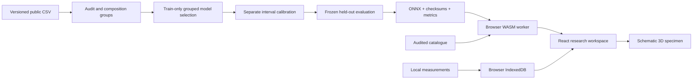

# Materials Lab

A browser research workspace for documented aluminium tensile properties. Three locally trained surrogates connect measured evidence, calibrated uncertainty and a schematic 3D tensile specimen.

**Private release candidate. GitHub Pages is disabled. Public release requires the owner's explicit decision.**


## Explore

- Search 972 audited records and inspect recorded composition and processing state.
- Run three real ONNX models locally, with 90% prediction intervals and training-support indicators.
- Orbit a schematic tensile apparatus; play, pause or inspect its illustration stage.
- Compare up to four specimens, export CSV/JSON, and inspect exact measured/predicted values.
- Import local laboratory CSVs and compare measured values against the catalogue-constrained predictions. Imported data stays on the device.
- Inspect held-out metrics, source attribution, exclusions and model limitations.

The scene illustrates the procedure; it does not simulate deformation or predict fracture. There are no arbitrary composition, temperature, strain-rate or weapon-performance controls.

## Run locally

Requires Node.js 24+ and Python 3.12 for training and model verification.

```bash
npm ci
npm run assets
npm run dev
```

Open `http://127.0.0.1:5173/materials-lab/`. Production preview:

```bash
npm run build
npm run preview -- --port 4173
```

The committed model package is sufficient for browser inference. No API key, cloud account or Python server is needed.

## Train and verify

```bash
python3 -m venv .venv
source .venv/bin/activate
pip install -r requirements.lock
python scripts/train.py
python scripts/verify_model.py
python -m pytest -q
npm run check
npx playwright install chromium webkit
npm run test:e2e
```

The original CSV is committed with attribution. `python scripts/fetch_data.py` can retrieve exactly that version and verifies the publisher's checksum before replacing the snapshot. Training never uses private browser imports. Retraining is a deliberate local operation; deployment does not retrain.

## Evidence

Source: Bhat, Barnard and Birbilis (2023), [Aluminium alloy dataset for supervised learning](https://doi.org/10.17632/b6br4yk6r3.1), Mendeley Data V1, CC BY 4.0. See [data provenance](data/SOURCES.md), [model card](public/models/MODEL_CARD.md), [frozen metrics](public/models/metrics.json) and [decisions](DECISIONS.md), and [validation record](VALIDATION.md).

Held-out MAE: yield 35.75 MPa; tensile 32.29 MPa; elongation 2.87 percentage points. These are internal group-separated evaluations, not independent laboratory validation. The model's wide intervals and varying state-level errors are deliberately visible.

## Architecture



React 19 / React Three Fiber 9 / Three.js / Zustand / D3 / Tailwind / Vite. ONNX Runtime assets are copied from the same installed package version. Models and data are checksum-verified; the app remains usable without persistent cache, and shows a 2D fallback if WebGL fails. Font files are self-hosted.

## Private-to-public release

1. Pass local checks and package the frozen models with `python scripts/package_model.py`.
2. Push only the completed candidate to the **private** repository and pass CI.
3. Review the candidate, reports and local preview with the owner. Leave Pages disabled.
4. After explicit approval, make the repository public and tag the accepted commit `v1.0.0`.
5. Enable Pages with GitHub Actions and manually run **Publish approved release** for that tag. The workflow refuses private repositories and never changes repository visibility.

The planned public URL is `https://jaworskig00.github.io/materials-lab/`; it is not an active deployment claim. The Vite base path and hash navigation support this project URL. Rollback uses a previously verified release tag through the same manual workflow.

## License and author

Application code: MIT. Source data and derived model weights: CC BY 4.0 with source attribution. Fonts: their bundled SIL Open Font License. Dependencies retain their respective licenses.

[Grzegorz Jaworski](https://gj-dev.com) · [GitHub](https://github.com/jaworskig00) · [LinkedIn](https://linkedin.com/in/jaworskig00)
