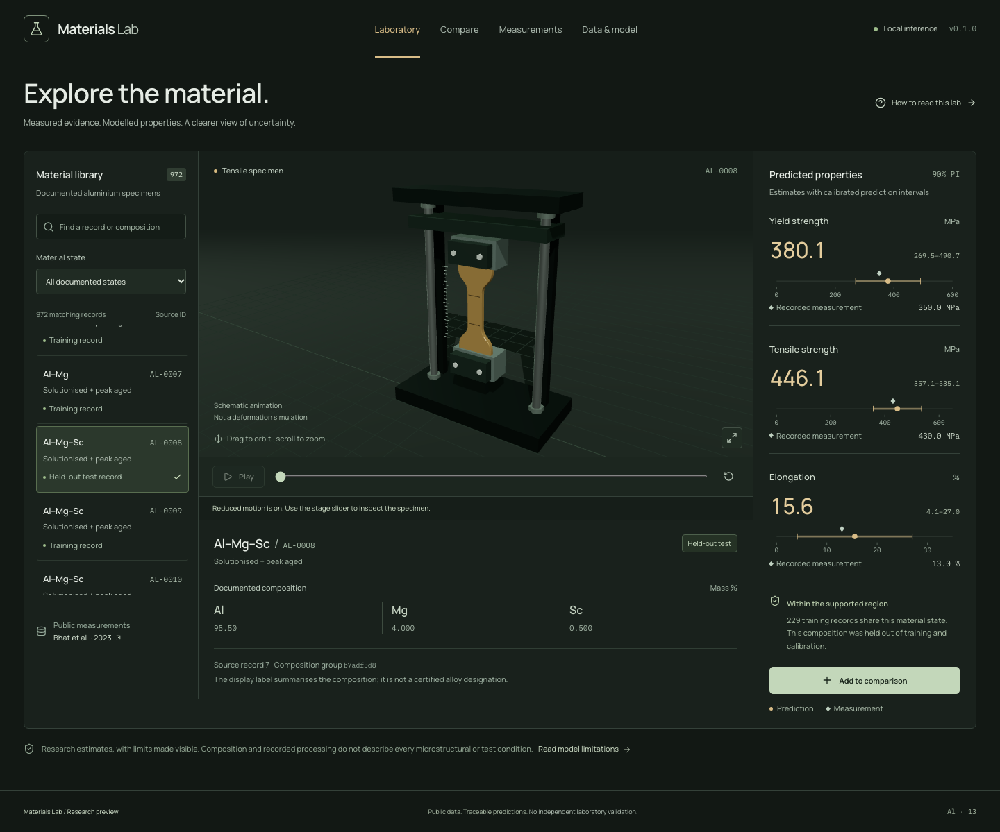
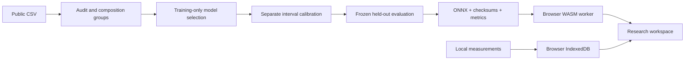

# Materials Lab

[](https://github.com/jaworskig00/materials-lab/actions/workflows/ci.yml)
[](LICENSE)
[](NOTICE.md)

Explore documented aluminium tensile properties with three locally trained machine-learning models, visible prediction uncertainty and an interactive 3D tensile-test illustration.

**[Open the application](https://jaworskig00.github.io/materials-lab/)** · [Download a release](https://github.com/jaworskig00/materials-lab/releases) · [Model card](public/models/MODEL_CARD.md) · [Validation record](VALIDATION.md)



## What you can do

- Search **972 audited records** by composition summary or source ID and filter their documented processing states.
- Estimate yield strength, tensile strength and elongation with **90% prediction intervals**, alongside available measured values.
- Inspect a 3D tensile fixture through three camera views. Play Mount → Pull → Hold, change speed, scrub, and compare with the original outline.
- Save up to four specimens, compare their evidence and export CSV or JSON.
- Import your laboratory measurements as CSV and see differences from the catalogue predictions.
- Inspect data provenance, exclusions, test errors, model version and support indicators.

## Try it

1. Choose a catalogue record in **Laboratory**. Read its processing state and whether it belongs to training, calibration or held-out testing.
2. Inspect the predictions and their intervals; select **Play** or **Specimen close-up** to explore the illustration.
3. Select **Add to comparison**, or open **Measurements** and download the CSV template before importing measurements.

The 3D sequence is deliberately exaggerated and identical for every material. It does not consume model predictions or simulate real deformation, fracture or a full stress–strain curve.

## Research scope and limitations

This is a civilian, catalogue-constrained research and educational tool. It does not design new alloys or accept arbitrary composition, temperature, strain-rate or geometry inputs.

The models were evaluated on composition groups excluded from fitting, model selection and calibration. Their held-out mean absolute errors are **35.75 MPa** for yield strength, **32.29 MPa** for tensile strength and **2.87 percentage points** for elongation. See the [full metrics](public/models/metrics.json) for baseline comparisons, interval coverage, sample counts and subgroup errors.

These are internal results from one compiled dataset, **not independent laboratory validation or material certification**. Processing labels omit important test and microstructural conditions. Intervals can be wide; data-support indicators are heuristics. Records used in training are clearly labelled and do not establish generalisation.

## Privacy and browser requirements

Inference runs in a Web Worker on your device. Imported CSV contents and saved comparisons stay in browser IndexedDB; they are not uploaded or automatically used for training. Clearing browser site data removes local work, so export comparisons you want to retain.

The app has no accounts, analytics or inference server. GitHub Pages serves its static assets, including models, runtime and fonts. A current browser with WebAssembly is required; WebGL enables the 3D scene, with a 2D fallback otherwise. Keyboard controls and reduced-motion preferences are supported. Chromium and WebKit are covered by browser tests.

## Run locally

Requires **Node.js 24+**. Python is only needed for model verification or training.

```bash
git clone https://github.com/jaworskig00/materials-lab.git
cd materials-lab
npm ci
npm run assets
npm run dev
```

Open [localhost:5173/materials-lab](http://127.0.0.1:5173/materials-lab/). For the production build:

```bash
npm run build
npm run preview -- --port 4173
```

Committed models are sufficient for inference. No API key or Python server is needed. `private: true` in package.json prevents accidental npm publication; it does not control GitHub visibility.

## Verify and reproduce

Use **Python 3.12** and the pinned dependency lock:

```bash
python3 -m venv .venv
source .venv/bin/activate
pip install -r requirements.lock
python scripts/verify_model.py
python -m pytest -q
npm run check
npx playwright install --with-deps chromium webkit
npm run test:e2e
```

The suite includes 11 unit tests, four Python tests and 14 browser tests across Chromium and WebKit. CI verifies the frozen model package without retraining.

For deliberate retraining, run `python scripts/train.py`, then repeat the checks. The original CSV is included with attribution. `python scripts/fetch_data.py` retrieves the pinned source version and verifies its SHA-256 checksum. Training preserves missing targets and uses composition-group separation, training-only model selection and a separate calibration partition.

## Data and citation

Ninad Bhat, Amanda S. Barnard and Nick Birbilis (2023), **Aluminium alloy dataset for supervised learning**, Mendeley Data, V1. [DOI: 10.17632/b6br4yk6r3.1](https://doi.org/10.17632/b6br4yk6r3.1). Licensed under [CC BY 4.0](https://creativecommons.org/licenses/by/4.0/).

The derived catalogue removes 181 exact duplicates and one inconsistent measurement record, preserves source identifiers, and displays mass fractions as percentages. [Data provenance](data/SOURCES.md) records the checksum and all transformations. The original authors do not endorse this application. Cite the dataset when using its data; [CITATION.cff](CITATION.cff) provides the software citation.

## Architecture and releases

React 19, TypeScript, Vite, Tailwind, Three.js / React Three Fiber, Zustand and D3. Python / scikit-learn trains three Random Forest regressors; ONNX Runtime Web executes the frozen models in single-thread WASM.



**Application v1.0.0 uses model package 0.1.0.** Their versions are independent. Model weights were not retrained for the public release. Each model archive includes a source commit and checksums.

Pages deployment is a manually triggered [release workflow](.github/workflows/publish.yml). It checks out a reviewed tag, runs the checks, and deploys that static build under `/materials-lab/`. Ordinary pushes only run validation. See [release procedure](docs/RELEASING.md) and [implementation decisions](DECISIONS.md).

## Contributing and licenses

[Contribution guide](CONTRIBUTING.md) · [Report a bug](https://github.com/jaworskig00/materials-lab/issues) · [Security reporting](SECURITY.md)

- Application code and authored documentation: **[MIT](LICENSE)**.
- Source data, derived catalogue and model weights: **[CC BY 4.0](licenses/CC-BY-4.0.txt)**, with attribution and changes documented in [NOTICE.md](NOTICE.md).
- Fonts and third-party dependencies retain their own licenses. The static build includes [third-party notices](public/THIRD_PARTY_NOTICES.txt).

Created by [Grzegorz Jaworski](https://github.com/jaworskig00).
